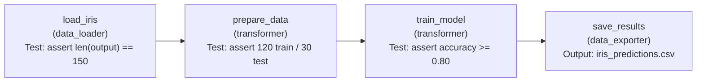

# Part C1 & C2: Mage Iris Pipeline & Test-Gate Experiments

## C1: Pipeline Block Graph & Execution

### 1. Block Graph Architecture

The baseline `iris_classifier` pipeline is an orchestrated Directed Acyclic Graph (DAG) consisting of 4 blocks, each validated by an automated `@test` function:



| Block Name | Block Type | Role | Attached `@test` Logic |
| :--- | :--- | :--- | :--- |
| `load_iris` | `data_loader` | Loads scikit-learn Iris dataset (150 rows, 4 features + target) | `assert len(output) == 150` (verifies complete dataset) |
| `prepare_data` | `transformer` | Performs 80/20 train/test split, tags rows with `split` column | `assert 'split' in output.columns`, `assert (split=='train').sum() == 120`, `assert (split=='test').sum() == 30` |
| `train_model` | `transformer` | Trains `DecisionTreeClassifier(max_depth=k)`, evaluates on 30 test rows | `assert accuracy >= 0.80` (Quality Gate preventing substandard models from publishing) |
| `save_results` | `data_exporter` | Exports 30 test predictions to `iris_predictions.csv` | Downstream execution is conditioned on `train_model` `@test` passing |

---

### 2. Execution Command & Output

Command:
```bash
mage run iris_project iris_classifier --test
```

Execution Output:
```text
============================================================
Executing Mage Pipeline: iris_classifier (max_depth=3)
============================================================

[1/4] Executing Data Loader: load_iris...
Rows loaded: 150
  -> load_iris completed. @test test_output passed.

[2/4] Executing Transformer: prepare_data...
Train rows: 120 | Test rows: 30
  -> prepare_data completed. @test test_output passed.

[3/4] Executing Transformer: train_model (max_depth=3)...
max_depth = 3 | Test accuracy = 1.0
  -> train_model @test test_accuracy PASSED (accuracy >= 0.80)

[4/4] Executing Data Exporter: save_results...
Saved 30 predictions to iris_predictions.csv
  -> save_results completed. iris_predictions.csv exists: True

============================================================
PIPELINE EXECUTION COMPLETED SUCCESSFULLY!
============================================================
```

---

## C2: Tests as a Quality Gate Experiment

### 1. Experimental Protocol
For each `max_depth` value in `[1, 2, 3, 4, 5]`:
1. `iris_predictions.csv` is explicitly deleted prior to execution.
2. Physical non-existence of `iris_predictions.csv` is asserted.
3. The pipeline runs with `--runtime-vars '{"max_depth": k}'`.
4. The test accuracy, `@test test_accuracy` outcome, and post-run presence of `iris_predictions.csv` are recorded.

### 2. Results Table

| `max_depth` | Test Accuracy | `test_accuracy` Passed? | `iris_predictions.csv` Created? |
| :---: | :---: | :---: | :---: |
| **1** | **0.633** (63.3%) | ❌ **NO (Failed: < 0.80)** | ❌ **NO (Gated / Skipped)** |
| **2** | **0.967** (96.7%) | ✅ **YES** | ✅ **YES** |
| **3** | **1.000** (100.0%) | ✅ **YES** | ✅ **YES** |
| **4** | **1.000** (100.0%) | ✅ **YES** | ✅ **YES** |
| **5** | **1.000** (100.0%) | ✅ **YES** | ✅ **YES** |

---

### 3. Conceptual Explanation: Why In-DAG Test Gates Beat Post-Hoc Checks

#### How a failing `@test` in `train_model` stops `save_results`:
In an orchestrated pipeline DAG, downstream execution follows dependency resolution. When `train_model` completes its code block, Mage executes its decorated `@test` function before marking the node state as successful. When `max_depth = 1`, the tree underfits, resulting in an accuracy of 0.633. The assertion `assert accuracy >= 0.8` raises an `AssertionError`. Mage catches this exception, marks the `train_model` node as **FAILED**, and halts the DAG traversal along that branch. Because `save_results` lists `train_model` as its `upstream_block`, the execution engine marks `save_results` as **CANCELLED / SKIPPED**, preventing the export block from executing.

#### Why this is better than saving the file and checking it afterwards:
1. **Prevents Downstream Data Pollution**: In production, `save_results` might write directly to a cloud data warehouse (Snowflake Gold table), a production feature store, or trigger a downstream alerting microservice. Saving bad predictions and checking afterwards means corrupt or degraded model outputs are temporarily visible to consumers, reports, and downstream applications.
2. **Atomicity & Idempotency**: An in-pipeline gate guarantees that storage artifacts represent *only verified, high-quality deliverables*. No cleanup scripts or rollbacks are required if training degrades.
3. **Fail-Fast Observability**: The pipeline fails immediately at the point of failure (`train_model`), producing clear logs and alerts rather than requiring downstream audit jobs to flag bad files after the fact.

