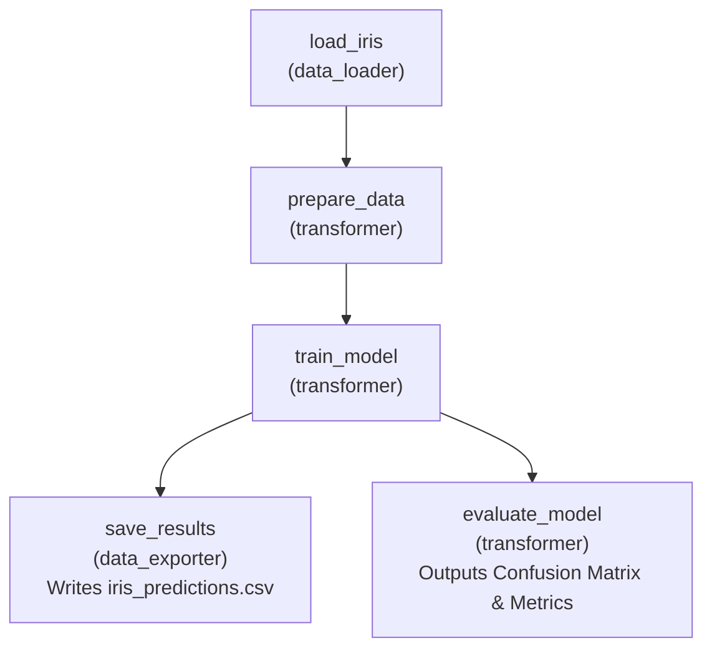

# Part C3 & C4: Evaluation Branch and Custom Block

## C3: Evaluation Branch Implementation

### 1. Architectural Architecture: The Forked DAG

In Part C3, `evaluate_model` is added as a parallel downstream consumer of `train_model`, creating a branching topology:



### 2. Updated `metadata.yaml`

```yaml
blocks:
- name: load_iris
  uuid: load_iris
  type: data_loader
  language: python
  upstream_blocks: []
  downstream_blocks: [prepare_data]
- name: prepare_data
  uuid: prepare_data
  type: transformer
  language: python
  upstream_blocks: [load_iris]
  downstream_blocks: [train_model]
- name: train_model
  uuid: train_model
  type: transformer
  language: python
  upstream_blocks: [prepare_data]
  downstream_blocks: [save_results, evaluate_model]
- name: save_results
  uuid: save_results
  type: data_exporter
  language: python
  upstream_blocks: [train_model]
  downstream_blocks: []
- name: evaluate_model
  uuid: evaluate_model
  type: transformer
  language: python
  upstream_blocks: [train_model]
  downstream_blocks: []
name: iris_classifier
uuid: iris_classifier
type: python
variables:
  max_depth: 3
```

### 3. Execution Evidence: Confusion Matrix & Metrics Table

When executed with `max_depth = 3`:

#### Confusion Matrix:
```
predicted    0    1    2
actual                 
0           10    0    0
1            0    9    0
2            0    0   11
```
*(All 30 test records correctly classified: 10 Setosa, 9 Versicolor, 11 Virginica).*

#### Classification Metrics Table:
| Metric | Score | Explanation |
| :--- | :---: | :--- |
| **Accuracy** | **1.000** | $30 / 30$ predictions correct |
| **Precision (macro)** | **1.000** | Perfect precision across all 3 classes with zero false positives |
| **Recall (macro)** | **1.000** | Perfect sensitivity with zero false negatives |
| **F1-Score (macro)** | **1.000** | Harmonic mean of precision and recall |

---

## C4: Custom Data-Quality Block (`check_no_missing`)

### 1. Block Overview
- **Name**: `check_no_missing`
- **Type**: `transformer`
- **Location**: Inserted immediately after `load_iris` and before `prepare_data`.
- **Purpose**: Validates incoming raw feature data before performing train/test partitioning.

### 2. Implementation Code (`iris_project/transformers/check_no_missing.py`)
```python
import pandas as pd

if 'transformer' not in globals():
    try:
        from mage_ai.data_preparation.decorators import transformer
    except ImportError:
        def transformer(fn): return fn

if 'test' not in globals():
    try:
        from mage_ai.data_preparation.decorators import test
    except ImportError:
        def test(fn): return fn


@transformer
def check_data(df, *args, **kwargs):
    """
    Validate that the raw dataset has:
    1. No missing/null values in any feature column.
    2. Exactly 3 unique target classes.
    """
    missing_count = df.isnull().sum().sum()
    unique_classes = df['target'].nunique()
    print(f'Validation: Missing values = {missing_count}, Unique classes = {unique_classes}')
    return df


@test
def test_data_quality(output, *args):
    assert output.isnull().sum().sum() == 0, 'Dataset contains missing values!'
    assert output['target'].nunique() == 3, f'Expected 3 classes, got {output["target"].nunique()}'
```

### 3. Verification & CI Passing
- The block runs automatically during pipeline execution and asserts zero nulls and 3 unique classes.
- All existing CI tests (`tests/test_prepare_data.py`) continue to pass without regression.

