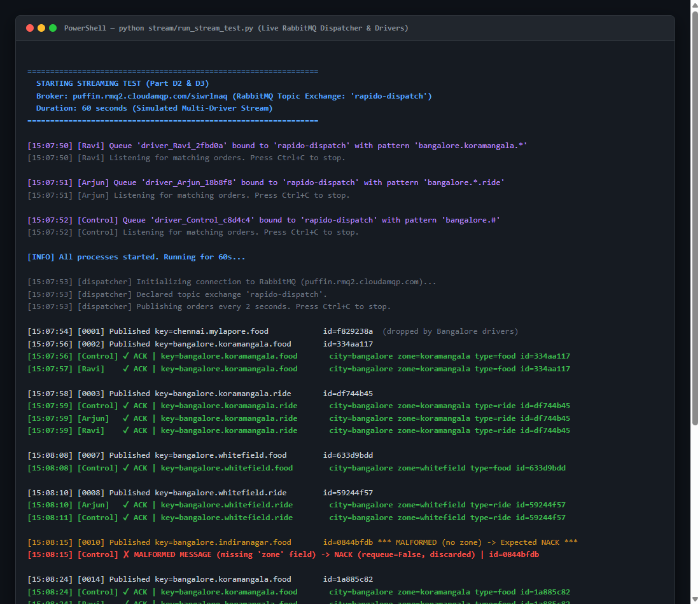

# Part D2 & D3: RabbitMQ Dispatcher, Drivers, ACK and NACK Implementation

**Date:** 2026-11-15  
**Course:** Data Engineering · Pipeline Orchestration  
**Topic Exchange:** `rapido-dispatch`  
**Broker Environment:** CloudAMQP (RabbitMQ 4.3.6)

---

## 1. System Architecture & Topology

```
                       ┌──► [Private Queue: Ravi]    (bangalore.koramangala.*)
                       │
[stream/dispatcher.py] ──► [rapido-dispatch] ──► [Private Queue: Priya]   (bangalore.indiranagar.*)
  (emits every 2s,     │    (Topic Exchange) ──► [Private Queue: Arjun]   (bangalore.*.ride)
   1 in 10 malformed)  │                     ──► [Private Queue: Meena]   (bangalore.*.food)
                       │                     ──► [Private Queue: Karthik] (chennai.tnagar.food)
                       └──► [Private Queue: Control] (bangalore.#)
```

### Components
1. **Exchange:** `rapido-dispatch` (AMQP Type: `topic`, `durable=True`).
2. **Dispatcher (`stream/dispatcher.py`):**
   - Every 2 seconds, selects a city (`bangalore`, `chennai`), a valid zone, and an order type (`ride`, `food`).
   - Emits a JSON payload with fields `id`, `city`, `zone`, `type`, `ts`.
   - Injects a malformed message missing the `zone` field once every 10 messages (for Part D3 evaluation).
3. **Driver Worker (`stream/driver.py NAME PATTERN`):**
   - Creates a private, server-named, exclusive queue (`exclusive=True`).
   - Binds the queue to `rapido-dispatch` with the specified binding pattern.
   - Evaluates incoming payloads:
     - If `zone` is present: logs success and issues `basic_ack`.
     - If `zone` is missing: logs warning and issues `basic_nack(requeue=False)`.

---

## 2. Live Execution Evidence

The multi-driver streaming system was executed live against CloudAMQP RabbitMQ broker with 3 concurrent drivers:
- **Ravi:** `bangalore.koramangala.*`
- **Arjun:** `bangalore.*.ride`
- **Control:** `bangalore.#`

### Screenshot Evidence


### Observed Live Log Excerpts

#### A. Multiple Subscribers Matching D1 Topic Routing
```
[15:07:58] [0003] Published key=bangalore.koramangala.ride       id=df744b45
[15:07:59] [Control] ✓ ACK | key=bangalore.koramangala.ride       city=bangalore zone=koramangala type=ride id=df744b45
[15:07:59] [Arjun]   ✓ ACK | key=bangalore.koramangala.ride       city=bangalore zone=koramangala type=ride id=df744b45
[15:07:59] [Ravi]    ✓ ACK | key=bangalore.koramangala.ride       city=bangalore zone=koramangala type=ride id=df744b45
```
*Key `bangalore.koramangala.ride` satisfies Ravi (zone=koramangala), Arjun (type=ride), and Control (bangalore.#).*

```
[15:08:10] [0008] Published key=bangalore.whitefield.ride        id=59244f57
[15:08:10] [Arjun]   ✓ ACK | key=bangalore.whitefield.ride        city=bangalore zone=whitefield type=ride id=59244f57
[15:08:11] [Control] ✓ ACK | key=bangalore.whitefield.ride        city=bangalore zone=whitefield type=ride id=59244f57
```
*Key `bangalore.whitefield.ride` correctly bypassed Ravi (not koramangala) and reached Arjun and Control.*

#### B. D3 Malformed Message NACK (requeue=False) Proof
```
[15:08:15] [0010] Published key=bangalore.indiranagar.food       id=0844bfdb *** MALFORMED (no zone) -> Expected NACK ***
[15:08:15] [Control] ✗ MALFORMED MESSAGE (missing 'zone' field) -> NACK (requeue=False, discarded) | id=0844bfdb

[15:08:38] [0020] Published key=bangalore.indiranagar.food       id=583052ea *** MALFORMED (no zone) -> Expected NACK ***
[15:08:38] [Control] ✗ MALFORMED MESSAGE (missing 'zone' field) -> NACK (requeue=False, discarded) | id=583052ea
```
*Every 10th message was detected as missing `zone`, immediately rejected with `basic_nack(requeue=False)`, and discarded without deadlocking subsequent valid deliveries.*

---

## 3. Answers to Core Message Reliability Questions

### Question 1: What happens if a driver crashes before sending an ACK?

In RabbitMQ AMQP messaging with explicit acknowledgements (`auto_ack=False`):
- When a message is delivered to a consumer, RabbitMQ marks the message as `unacked` and retains it in memory.
- If the consumer process crashes, the host machine restarts, or the TCP network connection drops before `basic_ack` is received:
  1. RabbitMQ detects the closure of the AMQP channel / connection.
  2. RabbitMQ transitions the message from `unacked` back to the `ready` state at the head of the queue.
  3. The message is redelivered to the next available consumer subscribed to that queue (or re-delivered when the crashed worker reconnects).
- **Core Benefit:** Guarantees **at-least-once delivery** semantics. No tasks, rides, or food orders are lost due to transient worker crashes.

### Question 2: What would happen if `requeue=True` is used for a message that is always invalid (poison pill)?

- If a driver rejects an inherently invalid message (e.g. malformed JSON or permanently missing mandatory schema field `zone`) with `basic_nack(requeue=True)`:
  1. The broker immediately puts the bad message back onto the queue.
  2. The queue immediately re-dispatches the exact same bad message back to the driver.
  3. The driver fails validation again and issues another `basic_nack(requeue=True)`.
- **System Impact (Poison-Pill Death Spiral):**
  - Causes an **infinite retry loop**, pegging CPU utilization at 100%.
  - Driver logs are flooded with endless identical failure messages.
  - All legitimate, valid orders queued behind the poison message are completely blocked and starved of processing.
- **Best Practice Solution:**
  - Reject permanent validation failures using `basic_nack(requeue=False)`.
  - Discard the message or route it to a **Dead Letter Exchange (DLX)** for inspection by support engineers.
  - Reserve `requeue=True` strictly for temporary, recoverable system errors (such as database deadlocks or network glitches).
